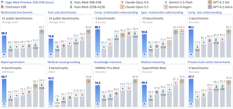
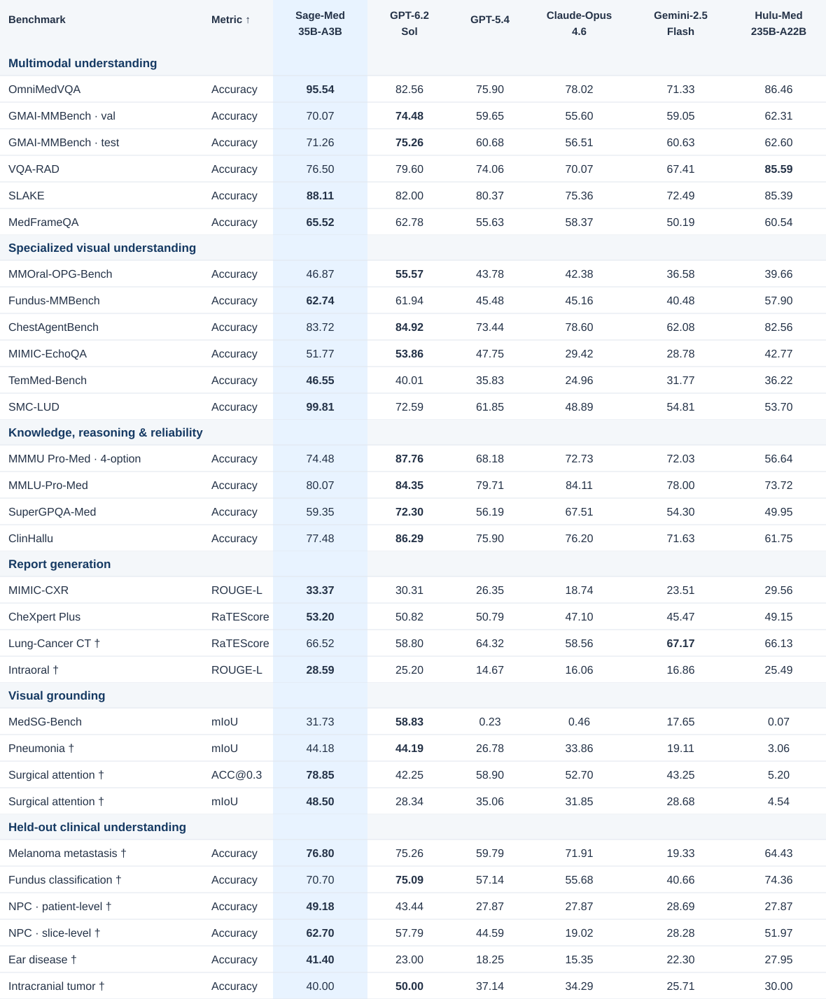
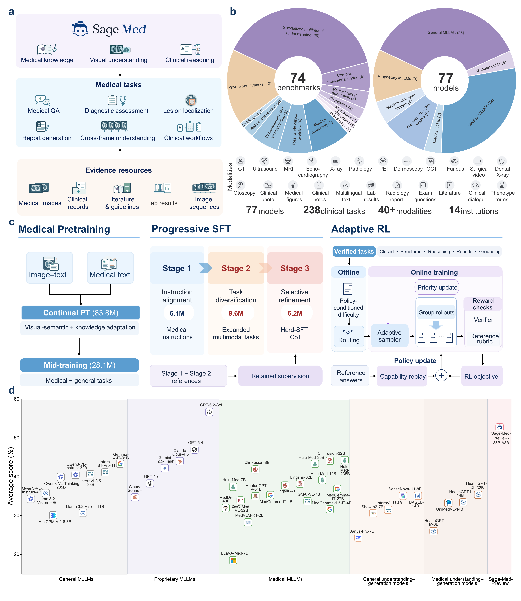

<p align="center">
  
</p>

<h1 align="center">Sage-Med-Preview</h1>

<p align="center">
  <b>Scaling Medical Multimodal Intelligence</b><br>
  Sage-Med Team · Shanghai Artificial Intelligence Laboratory
</p>

<p align="center">
  🌐 <a href="https://sage-med-preview.github.io/">Website</a> &nbsp; | &nbsp;
  📄 <a href="https://arxiv.org/abs/2611.34575">Paper</a> &nbsp; | &nbsp;
  🤗 <a href="https://huggingface.co/Sage-Med/Sage-Med-Preview">Hugging Face</a> &nbsp; | &nbsp;
  🏆 <a href="https://sage-med-preview.github.io/leaderboard.html">Leaderboard</a>
</p>

## Introduction

**Sage-Med-Preview** is a medical multimodal model developed by the **Shanghai Artificial Intelligence Laboratory**, built on **Intern-S2-Preview** with **35B total and 3B active parameters**. It brings medical knowledge, image understanding, report generation and visual grounding into one model.

## Highlights

- **Scaling medical multimodal intelligence.** A systematic exploration at hundred-million-record scale, using curated pools totaling approximately **164M records and 226B tokens**. Training combines continual pretraining, task-oriented mid-training, three-stage supervised fine-tuning (SFT), and difficulty-adaptive reinforcement learning (RL) with task-specific rewards and reference replay.
- **Strong performance with only 3B active parameters.** With **35B total parameters**, Sage-Med-Preview averages **58.26** across **31 public medical multimodal benchmarks**. This exceeds Hulu-Med-235B-A22B (**50.99**), Intern-S2-Preview (**52.24**), GPT-5.4 (**52.78**) and Claude-Opus-4.6 (**49.18**).
- **Strong medical understanding and report generation.** Sage-Med-Preview outperforms GPT-6.2-Sol on comprehensive multimodal understanding (**80.05 vs 76.81**), MIMIC-CXR report generation (**33.37 vs 30.31 ROUGE-L**), and MedFrameQA (**65.52 vs 62.78 accuracy**).
- **Broad evaluation and clinical transfer.** **238 clinical tasks · 74 benchmarks · 40+ modalities · 77 comparison models**, including private benchmarks from **14 hospitals and institutions**. Across 11 scores from nine held-out private understanding tasks, Sage-Med-Preview ranks first with **57.72**, ahead of runner-up GPT-6.2-Sol (**51.24**).

## Inference with vLLM

### Environment preparation

This setup was tested on a single NVIDIA H200 with BF16 and a 32,768-token context. Use an x86-64 Linux host with a CUDA 12.9-compatible NVIDIA driver. The [environment file](requirements-h200.txt) pins the CUDA 12.9 builds of vLLM and PyTorch.

```bash
pip install uv
uv venv --python 3.12 ~/.venvs/sage-med-vllm
source ~/.venvs/sage-med-vllm/bin/activate
curl -fsSL https://huggingface.co/Sage-Med/Sage-Med-Preview/resolve/main/requirements-h200.txt -o requirements-h200.txt
uv pip install --torch-backend=cu129 -r requirements-h200.txt
vllm download-kernels
```

### Run inference

#### Server

The first launch downloads about 131 GiB of model files from [Hugging Face](https://huggingface.co/Sage-Med/Sage-Med-Preview). Set `MODEL_PATH` to a local directory containing `config.json` and the weight shards to serve an existing copy.

```bash
MODEL_PATH="${MODEL_PATH:-Sage-Med/Sage-Med-Preview}"
PORT="${PORT:-8000}"
export VLLM_USE_FLASHINFER_SAMPLER=0

vllm serve "$MODEL_PATH" \
    --host 127.0.0.1 \
    --port "$PORT" \
    --trust-remote-code \
    --served-model-name sage-med-preview \
    --dtype bfloat16 \
    --tensor-parallel-size 1 \
    --gpu-memory-utilization 0.85 \
    --max-model-len 32768 \
    --max-num-seqs 8 \
    --max-num-batched-tokens 4096 \
    --limit-mm-per-prompt '{"image":1,"video":0}' \
    --generation-config vllm \
    --no-enable-prefix-caching \
    --enforce-eager \
    --default-chat-template-kwargs '{"enable_thinking":false}'
```

#### Client

This example sends an image and a text prompt and streams the response.

```bash
BASE_URL="${BASE_URL:-http://127.0.0.1:8000}"

curl --fail-with-body --silent --show-error --no-buffer \
    "$BASE_URL/v1/chat/completions" \
    -H 'Content-Type: application/json' \
    --data-binary @- <<'JSON'
{
  "model": "sage-med-preview",
  "messages": [
    {
      "role": "user",
      "content": [
        {
          "type": "image_url",
          "image_url": {
            "url": "https://storage.googleapis.com/hai-cd3-foundations-public-vault-entry/med_gemma/colab_example/cxr/chest_xray_pa_3-8-2010.jpeg"
          }
        },
        {
          "type": "text",
          "text": "Describe the visible findings in this chest radiograph."
        }
      ]
    }
  ],
  "chat_template_kwargs": {"enable_thinking": false},
  "max_tokens": 2048,
  "temperature": 0.01,
  "top_p": 1.0,
  "top_k": -1,
  "repetition_penalty": 1.0,
  "stream": true
}
JSON
```

## Evaluation

<p align="center">
  
</p>

The table compares Sage-Med-Preview with four proprietary models and Hulu-Med-235B-A22B across medical understanding, report generation, visual grounding and clinical transfer. **Scores are on a 0-100 scale; bold marks the highest score in each row.**

<p align="center">
  <a href="assets/benchmark-table.svg"></a>
</p>

<details>
<summary>View table as text</summary>

| Benchmark | Metric ↑ | **Sage-Med**<br>35B-A3B | GPT-6.2<br>Sol | GPT-5.4 | Claude-Opus<br>4.6 | Gemini-2.5<br>Flash | Hulu-Med<br>235B-A22B |
| :--- | :--- | ---: | ---: | ---: | ---: | ---: | ---: |
| **Multimodal understanding** | | | | | | | |
| OmniMedVQA | Accuracy | **95.54** | 82.56 | 75.90 | 78.02 | 71.33 | 86.46 |
| GMAI-MMBench · val | Accuracy | 70.07 | **74.48** | 59.65 | 55.60 | 59.05 | 62.31 |
| GMAI-MMBench · test | Accuracy | 71.26 | **75.26** | 60.68 | 56.51 | 60.63 | 62.60 |
| VQA-RAD | Accuracy | 76.50 | 79.60 | 74.06 | 70.07 | 67.41 | **85.59** |
| SLAKE | Accuracy | **88.11** | 82.00 | 80.37 | 75.36 | 72.49 | 85.39 |
| MedFrameQA | Accuracy | **65.52** | 62.78 | 55.63 | 58.37 | 50.19 | 60.54 |
| **Specialized visual understanding** | | | | | | | |
| MMOral-OPG-Bench | Accuracy | 46.87 | **55.57** | 43.78 | 42.38 | 36.58 | 39.66 |
| Fundus-MMBench | Accuracy | **62.74** | 61.94 | 45.48 | 45.16 | 40.48 | 57.90 |
| ChestAgentBench | Accuracy | 83.72 | **84.92** | 73.44 | 78.60 | 62.08 | 82.56 |
| MIMIC-EchoQA | Accuracy | 51.77 | **53.86** | 47.75 | 29.42 | 28.78 | 42.77 |
| TemMed-Bench | Accuracy | **46.55** | 40.01 | 35.83 | 24.96 | 31.77 | 36.22 |
| SMC-LUD | Accuracy | **99.81** | 72.59 | 61.85 | 48.89 | 54.81 | 53.70 |
| **Knowledge, reasoning & reliability** | | | | | | | |
| MMMU Pro-Med · 4-option | Accuracy | 74.48 | **87.76** | 68.18 | 72.73 | 72.03 | 56.64 |
| MMLU-Pro-Med | Accuracy | 80.07 | **84.35** | 79.71 | 84.11 | 78.00 | 73.72 |
| SuperGPQA-Med | Accuracy | 59.35 | **72.30** | 56.19 | 67.51 | 54.30 | 49.95 |
| ClinHallu | Accuracy | 77.48 | **86.29** | 75.90 | 76.20 | 71.63 | 61.75 |
| **Report generation** | | | | | | | |
| MIMIC-CXR | ROUGE-L | **33.37** | 30.31 | 26.35 | 18.74 | 23.51 | 29.56 |
| CheXpert Plus | RaTEScore | **53.20** | 50.82 | 50.79 | 47.10 | 45.47 | 49.15 |
| Lung-Cancer CT † | RaTEScore | 66.52 | 58.80 | 64.32 | 58.56 | **67.17** | 66.13 |
| Intraoral † | ROUGE-L | **28.59** | 25.20 | 14.67 | 16.06 | 16.86 | 25.49 |
| **Visual grounding** | | | | | | | |
| MedSG-Bench | mIoU | 31.73 | **58.83** | 0.23 | 0.46 | 17.65 | 0.07 |
| Pneumonia † | mIoU | 44.18 | **44.19** | 26.78 | 33.86 | 19.11 | 3.06 |
| Surgical attention † | ACC@0.3 | **78.85** | 42.25 | 58.90 | 52.70 | 43.25 | 5.20 |
| Surgical attention † | mIoU | **48.50** | 28.34 | 35.06 | 31.85 | 28.68 | 4.54 |
| **Held-out clinical understanding** | | | | | | | |
| Melanoma metastasis † | Accuracy | **76.80** | 75.26 | 59.79 | 71.91 | 19.33 | 64.43 |
| Fundus classification † | Accuracy | 70.70 | **75.09** | 57.14 | 55.68 | 40.66 | 74.36 |
| NPC · patient-level † | Accuracy | **49.18** | 43.44 | 27.87 | 27.87 | 28.69 | 27.87 |
| NPC · slice-level † | Accuracy | **62.70** | 57.79 | 44.59 | 19.02 | 28.28 | 51.97 |
| Ear disease † | Accuracy | **41.40** | 23.00 | 18.25 | 15.35 | 22.30 | 27.95 |
| Intracranial tumor † | Accuracy | 40.00 | **50.00** | 37.14 | 34.29 | 25.71 | 30.00 |

</details>

† Private benchmarks held out at both institution and case levels. ACC@0.3 measures localization accuracy at IoU > 0.3. The evaluation figure follows the report's panel definitions. Its report-generation panel includes PET/CT images overlapping with training data. PET/CT is excluded from the table above.

## Training Overview

**Medical pretraining → Progressive SFT → Adaptive RL**

Stage-specific curation draws on **322.7M candidate records before filtering**. Continual pretraining and task-oriented mid-training are followed by three SFT stages for instruction alignment, task diversification and selective refinement, then adaptive reinforcement learning with task-specific rewards and reference replay.

<p align="center">
  
</p>

## Intended Use

Sage-Med-Preview supports medical AI research and development, including medical question answering, image interpretation, report drafting and visual grounding. It is designed to assist researchers and healthcare professionals, with clinical applications requiring professional review and validation in the intended setting.

## Citation

If you find Sage-Med-Preview useful in your research, please consider citing our paper:

```bibtex
@misc{sagemed2026,
    title={Sage-Med: Scaling Medical Multimodal Intelligence},
    author={{Med Team} and Hu, Ming and Tang, Cheng and Li, Wei and others},
    year={2026},
    eprint={2611.34575},
    archivePrefix={arXiv},
    primaryClass={cs.CV},
    url={https://arxiv.org/abs/2611.34575}
}
```


## Contact

For inquiries, please contact [huming@pjlab.org.cn](mailto:huming@pjlab.org.cn) and [chenyirong@pjlab.org.cn](mailto:chenyirong@pjlab.org.cn).
